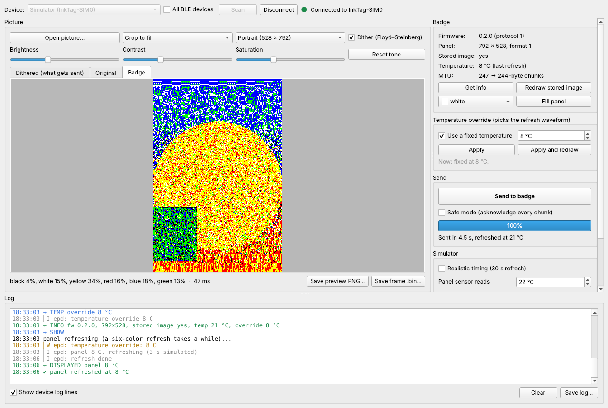

# Ink Tag Dev Tool

A desktop window for developing and debugging the Ink Tag badge: pick a picture, see exactly what the six-color panel will get, send it over Bluetooth with a progress bar, and watch every command, reply and device log line in one place. It has a built-in simulated badge, so all of it works before the hardware does.



## Setup (Windows)

1. Install Python 3.10 or newer from [python.org](https://www.python.org/downloads/) (tick "Add python.exe to PATH").
2. Copy the whole project folder so that `devtool` sits next to `firmware`. The tool uses `firmware/tools/inktag.py` for the palette, packing and protocol constants, so the GUI and the command-line tool never disagree.
3. Double-click `setup.bat` once. It makes a private Python environment in `devtool\.venv` and installs PySide6, Pillow, bleak and pyserial.
4. Double-click `run.bat` to start. You can also drop a picture on `run.bat`, or onto the open window.

On Mac or Linux: `python3 -m venv .venv && .venv/bin/pip install -r requirements.txt && .venv/bin/python -m inktag_devtool`.

## What's in the window

| Area | What it does |
|---|---|
| Device bar | Pick **Simulator** or press **Scan** to find real badges (Ink Tags are listed first; tick *All BLE devices* to see everything). Connect, and the tool reads the badge's info. |
| Picture | Open a picture, choose crop or fit, portrait or landscape, adjust brightness, contrast and saturation, and turn dithering on or off. The **Dithered** tab is the exact 792 × 528 six-color result, shown in pixels, not blurred. The line under it shows the color mix. **Badge** shows what the badge displayed after the last refresh. Save the preview as PNG or the raw 209,088-byte frame as `.bin`. |
| Badge | Firmware, panel size, whether an image is stored, the temperature from the last refresh, and the MTU. **Get info**, **Redraw stored image** (SHOW), and **Fill panel** with one color (CLEAR). |
| Temperature override | Sets a fixed temperature instead of reading the panel, which picks the refresh waveform. **Apply and redraw** sets it and redraws in one step, handy for comparing waveforms. Needs firmware 0.2.0 (see below). |
| Send | Uploads the picture with speed and time left, then waits for the refresh. The button becomes **Cancel** during an upload, which sends ABORT. *Safe mode* asks for an acknowledgement on every chunk, for flaky links. |
| Simulator | Shown when connected to the simulator: realistic timing (30 s refresh, slower transfer), what its "sensor" reads, act like firmware 0.1, and corrupt the next upload to check CRC error handling. |
| USB serial log | Opens the badge's USB port and puts its ESP-IDF log lines (gray, warnings in amber, errors in red) into the same log as the Bluetooth traffic. It keeps DTR/RTS low so opening the port doesn't reset the board. |
| Log | Blue `→` is what the tool sent, green `←` is what the badge answered, gray `▏` is the badge's own log. Save it to a file to share. |

## Firmware 0.2.0: temperature over Bluetooth

The firmware only had the fixed temperature as a build option. This tool came with a small firmware change that adds a `TEMP` command (`0x07`, one signed byte in °C, or −128 to read the panel again). It answers with INFO, which now ends with the current override. It is documented in `firmware/docs/PROTOCOL.md`.

- The setting lives in RAM and resets on reboot. If `CONFIG_INKTAG_TEMP_OVERRIDE` is set in menuconfig, that is the starting value.
- The source change is in `main/protocol.h`, `main/main.c` and `main/epd_uc8279.c/.h`. It has **not been compiled yet**, and `firmware/prebuilt/inktag-esp32c3.bin` is still 0.1.0. With 0.1.0 the tool says the command isn't supported and everything else works.

## Firmware 0.3.0: panel id and measured colors

- At boot the badge reads its panel controller's id. The **Panel** line shows it, with a wiring warning when the panel didn't answer. Needs firmware 0.3.0, also not compiled yet; older firmware just doesn't show an id.
- Dithering and previews now use colors measured on a real six-color panel instead of pure RGB, so the preview looks like the badge will (duller white, darker red). They are borrowed measurements until we photograph our own panel.

## Code layout

```
inktag_devtool/
  app.py          the window (Qt); Bluetooth work runs on an asyncio thread
  protocol.py     TagClient: INFO, SHOW, CLEAR, TEMP, ABORT, upload; log descriptions
  imaging.py      picture -> dithered frame and back, built on firmware/tools/inktag.py
  ble_link.py     real badge over bleak
  fake_device.py  simulated badge that follows main/main.c
  serial_log.py   optional USB serial monitor
tests/            protocol tests against the simulator (python -m pytest tests)
```

To add a feature, add a method to `TagClient` (and the matching branch in `FakeTag.handle` so it can be tried without hardware), then a button in `app.py` that calls it through `self.run(...)`. Since the simulator and the real badge share `TagClient`, whatever works against the simulator is the same code that talks to the badge.

## Known limits

- Tested on Linux against the simulator only (the protocol tests and a scripted run of the window). It has not talked to a real badge or run on Windows yet.
- Windows picks the Bluetooth MTU itself; the tool shows what it got. If uploads fail, try *Safe mode*.
- Dithering uses pure RGB primaries, like `inktag.py`. Measuring the real panel colors later will make previews and dithering more faithful.
