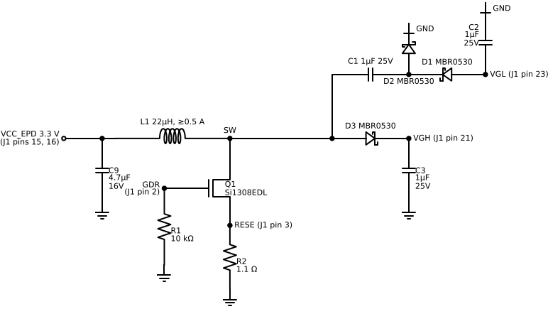

# Panel booster circuit

The TWE0368NW58 panel's controller makes its own ±15–20 V driving voltages, but only with a small external boost converter (switched through pins GDR and RESE) plus capacitors on its regulator pins. This is that circuit, taken from the panel datasheet's *Typical Application Circuit* (section 11, page 16). It sits between the panel's 24-pin ribbon and the ESP32-C3.

Draft for the prototype; not built or measured yet.

(Vector version: [booster.svg](booster.svg). Regenerate with [draw_schematic.py](draw_schematic.py).)

## How it works

- **Boost converter:** the controller switches Q1 through GDR. Current through L1 is measured across R2 (1.1 Ω) on RESE, which sets the current limit. R1 holds Q1 off while the controller is in reset.
- **VGH (about +20 V):** the switch node is rectified by D3 into C3.
- **VGL (about −20 V):** a charge pump: C1 couples the switch node to node X; D2 clamps X to ground, and D1 pulls VGL negative into C2.
- **VSH, VSL, VCOM, VDHR, VDDD:** made inside the controller, so each needs only a 1 µF capacitor to ground.

## Every J1 (panel) pin

| Pin | Name | Connect to |
|---|---|---|
| 1 | NC | nothing |
| 2 | GDR | Q1 gate, and R1 10 kΩ to GND |
| 3 | RESE | Q1 source, and R2 1.1 Ω to GND |
| 4 | NC | nothing |
| 5 | VDHR | C4 1 µF/25 V to GND |
| 6 | TSCL | nothing (optional external temperature sensor) |
| 7 | TSDA | nothing (same) |
| 8 | BS | GND through R3 0 Ω, or a wire: selects 4-wire SPI |
| 9 | BUSYN | C3 SuperMini GPIO 3 |
| 10 | RSTN | GPIO 10 |
| 11 | D/C | GPIO 5 |
| 12 | CSB | GPIO 7 |
| 13 | SCL | GPIO 4 |
| 14 | SDA | GPIO 6 |
| 15 | VDDIO | 3.3 V (VCC_EPD) |
| 16 | VCC | 3.3 V (VCC_EPD) |
| 17 | VSS | GND |
| 18 | VDDD | C8 1 µF/6 V to GND |
| 19 | VPP | nothing |
| 20 | VSH | C5 1 µF/25 V to GND |
| 21 | VGH | D3 cathode and C3 (booster output) |
| 22 | VSL | C6 1 µF/25 V to GND |
| 23 | VGL | D1 anode and C2 (charge pump output) |
| 24 | VCOM | C7 1 µF/25 V to GND |

VCC_EPD is the SuperMini's 3V3 pin, with C9 4.7 µF next to L1. All grounds are common with the SuperMini's GND.

## Parts list

The **Datasheet part** column is what page 16 shows. The **Easier to hand-solder** column is my suggestion for a perfboard prototype: each one meets the ratings the datasheet sets (MOSFET and diodes at least 30 V and 0.5 A, MOSFET on-resistance at most 400 mΩ at 2.5 V gate drive, inductor at least 0.5 A), but they are not parts Topwin has tested.

| Ref | Qty | Value | Datasheet part | Easier to hand-solder |
|---|---|---|---|---|
| J1 | 1 | 24-pin FPC socket, 0.5 mm pitch | – | a 24-pin 0.5 mm **FPC breakout board** (socket already soldered, 2.54 mm pins out, no other parts on it) |
| Q1 | 1 | N-MOSFET, ≥30 V, ≥0.5 A, Rds(on) ≤400 mΩ @ 2.5 V | Vishay Si1308EDL (SC-70) | AO3400A (SOT-23), on a SOT-23-to-DIP breakout |
| D1, D2, D3 | 3 | Schottky, ≥30 V, ≥0.5 A | MBR0530 (SOD-123) | 1N5819 (40 V 1 A, through-hole) |
| L1 | 1 | 22 µH, ≥0.5 A | molded / shielded power inductor | radial through-hole 22 µH power inductor rated ≥0.5 A |
| R1 | 1 | 10 kΩ | – | 1/4 W through-hole |
| R2 | 1 | 1.1 Ω | – | 1/4 W through-hole, 1 % if you can |
| R3 | 1 | 0 Ω | – | a wire from BS to GND |
| C1–C7 | 7 | 1 µF, 25 V | – | 1 µF 50 V X7R ceramic |
| C8 | 1 | 1 µF, 6 V | – | same 1 µF 50 V X7R is fine |
| C9 | 1 | 4.7 µF, 16 V | – | 4.7 µF 25 V X7R ceramic |

The datasheet asks for a molded ("integrated") inductor to reduce audible noise. Any inductor rated 22 µH and 0.5 A works electrically.

## Building it

- **Keep it close to the panel.** The datasheet says to place these parts near the screen. Build the booster on the same small perfboard as the FPC breakout, with the loop L1 → Q1 → R2 → GND and the diodes as short as you can. Run only the 8 logic wires and power to the SuperMini.
- **Orientation:** the diode band is the cathode. D3 band toward VGH, D1 band toward node X (away from VGL), D2 band toward GND.
- **FPC breakout:** these boards are often double-sided; check that the side you solder to matches the side the ribbon's gold contacts face when inserted.
- **Before powering:** check with a multimeter that 3.3 V and GND aren't shorted, and that R2 measures about 1.1 Ω.

## Checking it works

During a refresh (while the panel flickers), measure against GND, carefully, with the probe on the capacitor leads:

- C3 (VGH): about +20 V
- C2 (VGL): about −20 V
- C5 (VSH): about +15 V, C6 (VSL): about −15 V

If VGH and VGL stay near 0 V while the panel should be refreshing, the boost isn't switching: check Q1's pins, R2's value, and the GDR and RESE connections.
